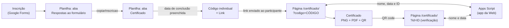

# Certificados de Leitura (Amor Pela Palavra) — Relatório de Progresso

**Data:** 26/10/2026 | **Sessão:** Desenvolvimento de 24 a 26/10/2026 | **Status:** Em produção para testes (falta o envio do link por e-mail)

---

## Objetivo

Emitir certificados de conclusão para os participantes dos grupos de leitura da Bíblia do **Projeto Amor Pela Palavra**, de forma automática e **autenticável**:

- o participante se inscreve por formulário;
- o coordenador registra a data de conclusão;
- o participante recebe um **link individual** e baixa o próprio certificado (PNG e PDF);
- o certificado traz um **ID** e um **QR code** que abre uma página de verificação no site `efatabook.com.br`.

---

## Visão geral da solução



| Componente | Função | Onde fica |
|---|---|---|
| Gerador em Python | Gera certificado (PNG + PDF + ID + QR) a partir de nome e data; serve de reserva e para uso manual | `~/certificados/` (máquina local) |
| Google Forms | Recebe as inscrições nos grupos | Conta Google da Efatá Book |
| Google Sheets | Registro central: inscritos, data de conclusão, código, ID e link | Planilha "Certificado da Biblia" |
| Google Apps Script | Gera os códigos, copia as inscrições e responde às consultas do site | Script vinculado à planilha |
| Página do site | Mostra e baixa o certificado (`?codigo=`) e verifica a autenticidade (`?id=`) | WordPress, página **Certificado** |

---

## Decisões de projeto

| Decisão | Motivo |
|---|---|
| ID no formato `APP-AAAA-XXXXXX` | Prefixo do projeto, ano e 6 caracteres aleatórios, fáceis de ler e digitar |
| Alfabeto do ID sem `I`, `L`, `O`, `0` e `1` | Evita confusão ao digitar o ID na página de verificação |
| Código individual de 12 caracteres hexadecimais | Torna o link impossível de adivinhar; só quem recebeu o link emite o certificado |
| O ID só nasce na primeira abertura do link individual | O certificado só é "emitido" quando o participante o acessa; reabrir o link devolve o mesmo ID |
| QR no formato `/certificado/?id=ID` | O formato `/certificado/ID` costuma dar erro 404 no WordPress sem regra extra no servidor |
| Parâmetro `codigo` no lugar de `c` | O parâmetro `c` falhava no app da Web do Google (ver "Problemas resolvidos") |
| Consulta pública devolve só nome e data (e o ID, no link individual) | E-mail e demais dados da inscrição nunca saem da planilha |
| Certificado montado no navegador do participante (canvas) | Dispensa servidor próprio e não exige guardar PDFs; o certificado pode ser refeito a qualquer momento |
| Assinaturas no próprio modelo (Canva) | Layout e fonte iguais ao restante do certificado, sem mexer no código |
| Envio do link pelo Brevo (planejado) | Limite de envio maior que o do Gmail do Google e remetente com o domínio do site |

---

## Etapas realizadas

### 1. Gerador em Python ✅

- Ambiente virtual (`.venv`) com `Pillow` e `qrcode[pil]`.
- Fontes: **Playball** (nome, estilo assinatura) e **Poppins Medium** (ID e data), baixadas do repositório `google/fonts`.
- Modelo em branco `modelo.png` (2000 × 1414 px), sem nome e sem QR, com duas assinaturas.
- Nome centralizado, com a **letra reduzida automaticamente** para nomes longos (testado até 67 letras).
- Saída em `saida/<ID>.png` e `saida/<ID>.pdf` (300 dpi).
- O QR gerado aponta para `https://efatabook.com.br/certificado/?id=<ID>`.

### 2. Planilha, formulário e códigos ✅

Colunas da aba **Certificado**:

| A | B | C | D | E | F | G | H |
|---|---|---|---|---|---|---|---|
| Nome | Grupo | E-mail | Conclusão | Código | ID | Emitido | Link |

- Quando o coordenador preenche **Nome** e **Conclusão**, o **Código** nasce sozinho (`gerarCodigosPendentes`, disparada por `onEdit`).
- O formulário "Inscrição Leitura Bíblica" tem as perguntas: Nome Completo, Grupo de leitura, E-mail e confirmação do nome.
- Grupos no formulário: **Leitura em 120 dias**, **Leitura em 01 ano**, **Leitura 02 anos** e **Leitura Livre**.
- Cada inscrição é copiada para a aba **Certificado** por `copiarInscricao`, que lê as respostas pelo **título** das perguntas (e não pela posição das colunas). Assim, perguntas novas não quebram o fluxo.
- Acesso do formulário: editor **Restrito**; participantes: **qualquer pessoa com o link**.

### 3. Consulta pública (app da Web do Apps Script) ✅

Duas rotas, devolvendo JSON:

| Rota | Uso | Resposta |
|---|---|---|
| `?codigo=CÓDIGO` | Link individual do participante | `ok`, `nome`, `data`, `id` (cria o ID e registra "Emitido" na primeira vez) |
| `?id=ID` | QR code e verificação | `ok`, `nome`, `data` |

Exemplo de resposta (dados fictícios):

```json
{"ok":true,"nome":"Maria Souza","data":"24/10/2026","id":"APP-2026-XXXXXX"}
```

Erros previstos: `parametro`, `codigo`, `id`, `nao_encontrado` e `interno`.

Endereço de publicação (guardado fora deste repositório público):

```
https://script.google.com/macros/s/<ID_DA_IMPLANTACAO>/exec
```

### 4. Páginas no site ✅

Uma única página **Certificado** (WordPress, bloco "HTML personalizado") com três comportamentos:

| Endereço | Comportamento |
|---|---|
| `/certificado/?codigo=CÓDIGO` | Mostra "Parabéns, NOME!", o certificado montado e os botões **Baixar PNG** e **Baixar PDF** |
| `/certificado/?id=ID` | Mostra "Certificado autêntico" com nome e data, ou "Certificado não encontrado" |
| `/certificado/` | Mostra uma caixa para digitar o ID |

Detalhes técnicos:

- Modelo em branco hospedado na biblioteca de mídia do WordPress (`certificado-modelo-app.png`).
- Desenho em `canvas` (2000 × 1414 px), com as mesmas posições do gerador em Python.
- Bibliotecas: `qrcode-generator` 1.4.4 e `jsPDF` 2.5.1, carregadas da CDN (cdnjs), com plano B na jsDelivr.
- Fontes carregadas do Google Fonts (Playball e Poppins).
- Nomes inseridos na página como **texto** (`textContent`), nunca como HTML.
- PDF em A4 paisagem, página única.

### 5. Coluna Link ⏳

Código entregue (`preencherLinks`, chamada por `onEdit`) para escrever, em cada linha com código, o endereço pronto `https://efatabook.com.br/certificado/?codigo=<CÓDIGO>`. **Teste pendente.**

---

## Testes realizados

| Teste | Resultado |
|---|---|
| Consulta por código (via `curl` no terminal) | ✅ Devolve nome, data e ID; o ID é o mesmo em consultas repetidas |
| Consulta por ID | ✅ Devolve só nome e data |
| Código inexistente | ✅ `nao_encontrado` |
| Página de verificação (ID válido e inválido) | ✅ "Certificado autêntico" e "Certificado não encontrado" |
| Emissão pelo link individual em janela privada | ✅ Certificado montado e baixado |
| Leitura do QR dentro do PNG e do PDF baixados | ✅ Abre `/certificado/?id=<ID>` |
| Nomes de 30, 56 e 67 letras | ✅ Cabem na área do nome, centralizados |
| Cópia de inscrição do formulário para a aba Certificado | ✅ Linha criada com nome, grupo e e-mail |
| Nascimento do código ao preencher a data | ✅ |

---

## Problemas resolvidos

| Problema | Solução |
|---|---|
| `cp` não achava o modelo na pasta Downloads | O arquivo tinha espaços e parênteses no nome; usar aspas e conferir o caminho |
| `sed` não alterava as posições no script | O espaçamento do script era diferente do esperado; usar `[[:space:]]*` no padrão |
| QR code sobre o nome da assinatura | O `sed` não tinha sido aplicado; QR movido para o canto superior direito do certificado |
| `~` colado no fim do endereço no terminal | Tecla `~` pressionada sem querer; conferir que o endereço termina em `/exec` |
| Apps Script não abria ("Não foi possível abrir o arquivo") | Navegador logado em mais de uma conta Google; usar janela privada com a conta certa |
| Aviso "O Google não verificou este app" | Esperado em scripts próprios; **Avançado → Acessar (não seguro) → Permitir** |
| Consulta por código devolvia "Página não encontrada" | Várias implantações antigas e, principalmente, o parâmetro `c`; arquivadas as antigas, mantida uma só, e trocado por `?codigo=` |
| Palavras trocadas na tela durante a conversa (o texto enviado estava correto) | Problema de exibição; causa não confirmada; normalizou depois de reiniciar o computador |
| Validação do e-mail no formulário estava como "Número" | Trocada para **Texto → E-mail** |
| Link de edição do formulário aberto a qualquer pessoa | Acesso de editor mudado para **Restrito** |

---

## Estado atual do projeto

**Pasta local:** `~/certificados/`

| Arquivo | Função |
|---|---|
| `gerar_certificado.py` | Gerador manual: `python gerar_certificado.py "Nome" "DD/MM/AAAA"` |
| `modelo.png` | Modelo em branco do certificado (cópia de `Certificado.png`) |
| `fontes/` | `Playball-Regular.ttf` e `Poppins-Medium.ttf` |
| `saida/` | PNG e PDF gerados |

**Funções do Apps Script (script vinculado à planilha):**

| Função | Papel |
|---|---|
| `gerarCodigosPendentes` | Cria o código das linhas com nome e data de conclusão |
| `onEdit` | Dispara a geração de códigos (e links) a cada edição |
| `onOpen` | Cria o menu **Certificados** na planilha |
| `copiarInscricao` | Copia a inscrição do formulário para a aba **Certificado** |
| `criarGatilhoInscricao` | Cria o gatilho "ao enviar o formulário" (executar uma vez) |
| `doGet` | Recebe as consultas do site (`?codigo=` e `?id=`) |
| `emitirPorCodigo_` | Localiza o código, cria o ID na primeira visita e registra "Emitido" |
| `verificarPorId_` | Confere o ID e devolve nome e data |
| `novoId_`, `dataTexto_`, `lerDados_` | Funções auxiliares |
| `preencherLinks` | Escreve o link individual na coluna **Link** (teste pendente) |
| `testarConsulta` | Função de teste; pode ser removida |

---

## Como usar (rotina do coordenador)

1. O participante se inscreve pelo formulário; a linha aparece sozinha na aba **Certificado**.
2. Ao concluir a leitura, o coordenador preenche a **Conclusão** (formato `DD/MM/AAAA`).
3. O **Código** (e o **Link**) aparecem sozinhos.
4. O coordenador envia o link ao participante (WhatsApp ou e-mail).
5. O participante abre o link, confere o certificado e baixa o PNG ou o PDF.
6. Qualquer pessoa pode conferir a autenticidade lendo o QR code do certificado.

Atenção: **não abrir o link de um participante real só para testar**, pois a primeira abertura cria o ID e registra a data em "Emitido".

Gerar um certificado manualmente (reserva):

```bash
cd ~/certificados && source .venv/bin/activate
python gerar_certificado.py "Nome da Pessoa" "DD/MM/AAAA"
```

Testar a consulta pelo terminal (trocar pelo endereço real e por um código de teste):

```bash
URL="https://script.google.com/macros/s/<ID_DA_IMPLANTACAO>/exec"
curl -sL "$URL?codigo=<CODIGO_DE_TESTE>"
```

---

## Segurança e privacidade

- A consulta pública devolve **apenas nome, data e ID**; o e-mail e os demais dados ficam só na planilha.
- O link individual usa um código de 12 caracteres hexadecimais (48 bits), inviável de adivinhar.
- O formulário informa ao participante para que os dados serão usados; o e-mail serve para enviar o link do certificado.
- A página escreve os nomes como texto, o que impede que um nome malicioso digitado no formulário execute código no site.
- O app da Web executa como o dono do script, com acesso "Qualquer pessoa", e só expõe o que o código devolve.
- Este repositório é **público**: não publicar o endereço real da implantação, o ID da planilha nem dados de participantes.

---

## Pendências e próximos passos

1. ⏳ Testar a coluna **Link** e usá-la na rotina de envio.
2. ⏳ **Enviar o link por e-mail pelo Brevo**: definir remetente (endereço do domínio do site), confirmar a autenticação do domínio e escrever o modelo do e-mail.
3. ⏳ Decidir se o formulário passa a pedir **WhatsApp** e **CEP** (definir a finalidade, atualizar a frase de privacidade e usar validação por expressão regular; os títulos novos não devem conter "nome completo", "grupo" nem "mail").
4. ⏳ Definir se o texto do certificado muda por grupo (120 dias, 01 ano, 02 anos, Leitura Livre) ou se continua único.
5. ⏳ Padronizar maiúsculas e minúsculas dos nomes antes de imprimir no certificado.
6. ⏳ Apagar as linhas de teste da planilha e a função `testarConsulta`.
7. ⏳ Guardar neste repositório o código-fonte (`gerar_certificado.py` e o script do Apps Script), sem endereços reais.
8. ⏳ Rotina de cópia de segurança da planilha (exportar de tempos em tempos).

---

> "Nem só de pão viverá o homem, mas de toda a palavra que sai da boca de Deus." (Mateus 4:4)
